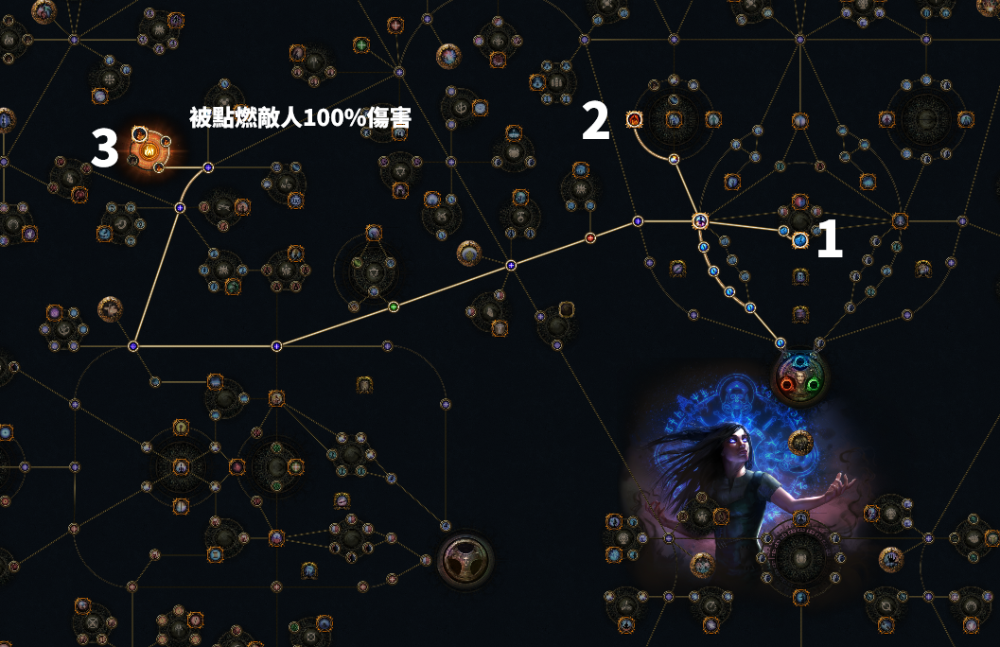
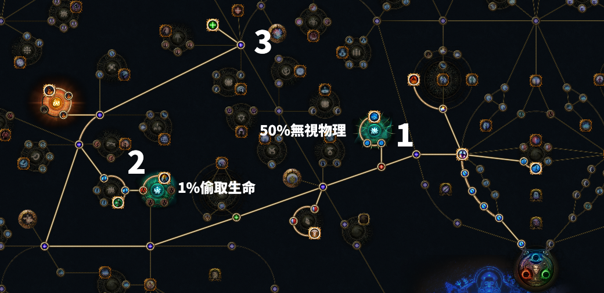
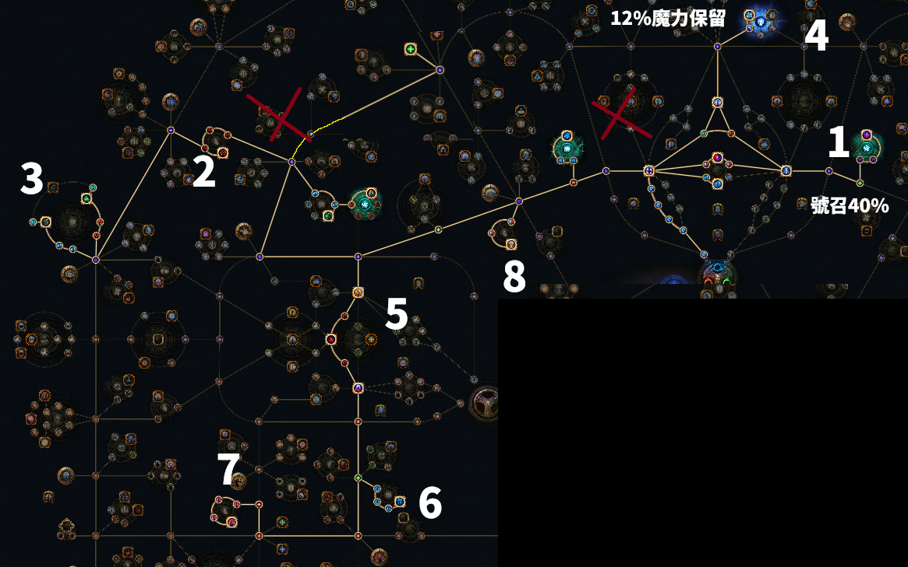

# 《流亡黯道》3.29 / 3.30 女巫死靈法師：幻化武器極速開荒章節全指南

> **指南定位**：專門針對 League Start（賽季首發）設計之女巫召喚開荒全流程指南。本指南整合自原作者 MME 之 Google 文件筆記與 4.5 小時實況通關影片，以官方繁體中文（Garena 譯名）全面校對，並內嵌作者原始天賦點法手繪進度圖解。

---

## 零、 攻略與原創資料來源 (Sources)

* **官方 YouTube 影片教學**：[POE1 3.29季前準備 死靈幻化武器 章節通關 全流程講解](https://www.youtube.com/watch?v=KJ62gmdByOE)（原作者：MME）
* **Google 文件筆記**：[MME 3.29 幻化武器開荒章節筆記](https://docs.google.com/document/d/1VMXcrCK23BhJWaf6VHsDOdb9Qc9kiIvX3vHiGosrnDA/edit?tab=t.0)

---

## 一、 流派核心觀念與操作常見問答 (Q&A)

### Q1：幻化武器該如何操作與跑圖？
* **召喚手法**：先使用綠色主動技能**【虛空刀雨】(Bladefall)** 施放在地面上，地面會掉落綠色靈魂劍刃；接著對準地面劍刃施放綠色主動技能**【幻化武器】(Animate Weapon)**，即可將靈魂劍刃化為漂浮飛刀跟隨戰鬥。
* **刷圖節奏**：每張地圖或章節地圖開頭，原地連續施放刀雨與幻化武器，在 3~5 秒內將飛刀招滿上限（15~18 把），接著開啟水銀藥劑一路散步衝刺。刀刃攻擊速度極快且自帶追蹤攻擊，清怪速度極高。
* **注意視線**：時不時留意畫面左上角的召喚物狀態欄，若飛刀數量因持續時間結束或死亡而下降，再隨手補一次「刀雨＋幻化武器」。遇到精英怪或章節 Boss 時，使用**【號召】(Convocation)** 將所有飛刀瞬間拉至王身邊集中集火。

### Q2：為什麼嚴格限制在「28 等」這個時間點才轉型幻化武器？
* 雖然幻化武器寶石 4 等就能取得，但前期地面沒有合適的武器可以幻化，若手動撿地上白裝或使用引導靈體極度拖慢節奏。
* 核心配套觸發器**【虛空刀雨】(Bladefall)** 的裝備需求等級剛好為 **28 等**（於第三章完成「圖書館任務」後向西歐莎購買）。
* 因此在 1~28 等期間，採用前期最強大的「神聖火舌圖騰＋召喚憤怒狂靈（火靈）」過渡，28 等一到立刻無縫切換，完全不浪費任何時間。

### Q3：前期如果想用「赦免 (Absolution)」練等可以嗎？
* **完全可以！**
* 赦免開荒的天賦走向與這套火靈/火舌點法高度重合，且赦免的好處是**28 等轉型時完全不需要退點**。如果喜歡赦免手感的玩家，可在 12 等直接領取赦免一路打到 28 等換幻化武器。

### Q4：商店篩選工具 (Regex 代碼)
* 進入各城鎮檢查防具與武器商人時，可將以下代碼複製貼上至商店搜尋列，快速標記可用之四連裝備與跑速鞋：
  ```text
  -[rgb]-.-|r-r-b|b-b-g|b-g-r|nne|rint
  ```
  *(代碼意義：篩選任意四連裝備、紅紅白、藍藍綠、藍綠紅三連，以及帶有跑速 runner / movement 的鞋子)*

---

## 二、 拓荒全期天賦走向與原創進度圖解

以下 3 張天賦加點圖直接提取自原作者 MME 之開荒筆記，清楚標註各階段編號加點順序與專精選取：

### 階段一：1 ~ 28 等前期拓荒（火靈 / 火舌圖騰過渡）



* **加點步驟解析**：
  1. **【步驟 1】**：女巫起手出門左轉，點出【亡者之靈】（提供召喚物生命與召喚數量上限）。
  2. **【步驟 2】**：向上點出【殘酷準備】（提供前期最大生命與召喚傷害路徑）。
  3. **【步驟 3】**：一路向左橫跨至聖堂武僧左上方，點出【火之化身】附近的召喚火傷大點，並選取召喚專精：
     > **核心專精**：**「被點燃的敵人受到召喚物 100% 增加傷害」**
  * **前期核心機制**：透過火舌圖騰（必定造成點燃）與火靈的火焰傷害，使所有被點燃的怪物承受 2 倍召喚傷害，Act 1 ~ 3 前期所有章節 Boss 均可在數秒內熔化。

---

### 階段二：28 等轉型幻化武器（Act 3 圖書館後 ~ Act 6）



* **加點步驟解析**：
  1. **【步驟 1】**：28 等完成圖書館任務取得虛空刀雨後，點出女巫出門左側召喚大點，選取召喚專精：
     > **核心專精**：**「召喚物無視敵人 50% 物理傷害減免 (Overwhelm)」**（幻化武器為純物理基底，此專精可直接擊穿 Boss 護甲）。
  2. **【步驟 2】**：點出下方召喚大點，選取召喚專精：
     > **核心生存專精**：**「召喚物造成傷害的 1% 偷取生命給自身」**（章節跑圖只要刀刃在打怪，玩家血量幾乎隨時處於滿血狀態）。
  3. **【步驟 3】**：開始往聖堂武僧上方拉伸，補齊智力、力量過路點與生命圈。

---

### 階段三：章節後期與終局收尾（Act 6 ~ Act 10）



* **加點步驟解析**：
  * **【紅色叉叉 (退點)】**：使用章節任務贈送的後悔點數，洗掉前期聖堂武僧左上方火之化身過路點與女巫內圈多餘點數，將點數回收重新分配。
  * **【步驟 1】**：點出女巫右上召喚圈，選取專精：
     > **核心手感專精**：**「號召 (Convocation) 具有 40% 增加冷卻回復速度」**（縮短號召 CD，保持刀刃常駐貼身與轉火）。
  * **【步驟 2 & 3】**：點出聖堂武僧左側生命圈與【堅定信念】。
  * **【步驟 4】**：點出上方魔力保留圈，選取專精：
     > **核心光環專精**：**「8% / 12% 增加魔力保留效能」**（用以同時開啟堅定、怨毒或元素淨化）。
  * **【步驟 5、6、7、8】**：一路貫穿至決鬥者上方，點出大量最大生命（步驟 5、6、7）與敏捷過路點（步驟 8），滿足高階綠色技能寶石（虛空刀雨、快速攻擊、多重打擊）的敏捷屬性門檻。

---

## 三、 章節技能配置與取得進度表

### 1. Act 1（第一章：1~12 等）
* **武器選擇**：找商人購買或撿取「附加點傷魔棒（電/火/冰點傷均可）」或帶有召喚傷害的魔杖/權杖。
* **1~4 等**：
  * 主力：【滾動岩漿】或【冰霜脈衝】 + 【秘術增強】
* **4~12 等（完成打破鳥蛋與開門任務）**：
  * 主力 1：【神聖火舌圖騰】 - 【燃燒輔助】 - 【幻生靈體】
  * 主力 2：【召喚憤怒狂靈】 - 【炎軍輔助】 - 【附加閃電傷害】
  * 位移與防禦：【烈焰衝刺】、【冰霜新星】（可用於觸發秘術增強）
* **8 等**：領取【霜暴】（附加冰緩地面降低怪物流動性）。

### 2. Act 2（第二章：12~23 等）
* **12 等**：
  * 若手感習慣赦免：可將狂靈替換為【赦免】 - 【附加閃電傷害】 - 【召喚物傷害】。
  * 繼續使用火靈：【召喚憤怒狂靈】 - 【近戰物理傷害】 - 【燃燒輔助】 / 【近戰濺射】。
* **16 等**：
  * 開啟輔助狀態：【灰燼之捷】（火靈/火舌增傷）、【清晰】（維持 1 等控制回魔）。
  * 實用詛咒：【導電】或【元素要害】。

### 3. Act 3（第三章：23~28 等）
* **24 等**：
  * 領取防禦與輔助詛咒：【堅定】（護甲光環）、【號召】、【血肉奉獻】。
* **28 等（完成圖書館任務後核心轉職）**：
  * **核心四連 (2藍1綠1紅 或 2綠1藍1紅)**：
    * **【幻化武器】 - 【召喚物傷害】 - 【快速攻擊】 - 【附加物理傷害】 / 【近戰物理傷害】**
    * *(打章節頭目時，可將附加物理傷害替換為【多重打擊】)*
  * **觸發工具 (3連：2綠1藍)**：
    * **【虛空刀雨】 - 【秘術增強】 - 【快速施法】**
  * **位移與光環**：
    * 【烈焰衝刺】、【號召】
    * 【堅定】 / 【元素淨化】 + 【清晰】(低等)
    * 【血肉奉獻】

### 4. Act 4 ~ Act 10（第四章至第十章進度重點）
* **昇華試煉完成後**：
  * 換上【憎恨】光環（大量物理額外冰傷）或保持【堅定】＋【元素淨化】（章節抗性無壓力）。
  * 增傷詛咒：【脆弱】（純物理幻化武器增傷首選）或【刺客印記】。
* **武器更新**：
  * 留意掉落之魔杖/權杖，使用改造石洗出「+1 全召喚技能寶石等級」或「增加召喚物傷害/攻速」。

---

## 四、 女巫昇華職業：死靈法師 (Necromancer) 點選順序

1. **第一次昇華（前置試煉完成，約 33 等）**：
   * **【黑暗統御者 (Commander of Darkness)】**：受你光環影響的友軍增加 30% 傷害，並使你與友軍獲得 **+30% 全元素抗性**。開荒點出後抗性直接滿溢，裝備壓力降到最低。
2. **第二次昇華（約 55 等）**：
   * **【無意識侵略 (Mindless Aggression)】**：召喚物增加 30% 移動速度、攻速與施法速度，並增加 30% 傷害。大幅強化刀刃追怪與擊殺頻率。
3. **第三次昇華（約 68 等，終章進入異界前）**：
   * **【骸骨屏障 (Bone Barrier)】**：大幅強化角色生存，提供基於召喚物數量的額外物理減傷、護甲與生命護盾。

---

## 五、 進入異界輿圖 (Maps) 轉型流派梯隊推薦

完成第十章後進入白圖，可依掉落之傳奇裝備或市場物價選擇轉型：

| 梯隊評級 | 推薦轉型流派 | 核心機制與優勢 | 轉型門檻 / 建議 |
| :---: | :--- | :--- | :--- |
| **T0 首選** | **【幻化武器：遠程之刃】**<br>*(Animate Weapon of Ranged Arms)* | 將近戰飛刀替換為**遠程漂浮弓箭手**，全螢幕多重箭矢自動索敵穿透，兼具極限清圖與極遠距離打王安全性。 | 取得變體寶石後直接無痛轉型，天賦與裝備 100% 相容。 |
| **T0 首選** | **【統帥之鏈】**<br>*(Chains of Command)* | 核心傳奇胸甲，給幻化守衛裝備傳奇雙手劍或大狂怒錘，擊殺怪物自動召喚 50+ 把幻化武器，真正解放雙手散步清圖。 | 造價極其低廉，早期即可成型。 |
| **T1 熱門** | **【蜘蛛刀 (阿茲卡利的獠牙)】**<br>*(Arakaali's Fang)* | 匕首自帶召喚 20 隻不死毒蜘蛛，刷圖自帶毒素擴散，攻守兼備。 | 需要特定傳奇匕首，開季前兩天價格較高。 |
| **T1 熱門** | **【毒信念聖物】**<br>*(Poison Holy Relic of Conviction)* | 3.24 崛起至今之頂級全通流派，高防禦、大範圍中毒清屏。 | 需要信念聖物變體寶石與特定冷卻裝備。 |
